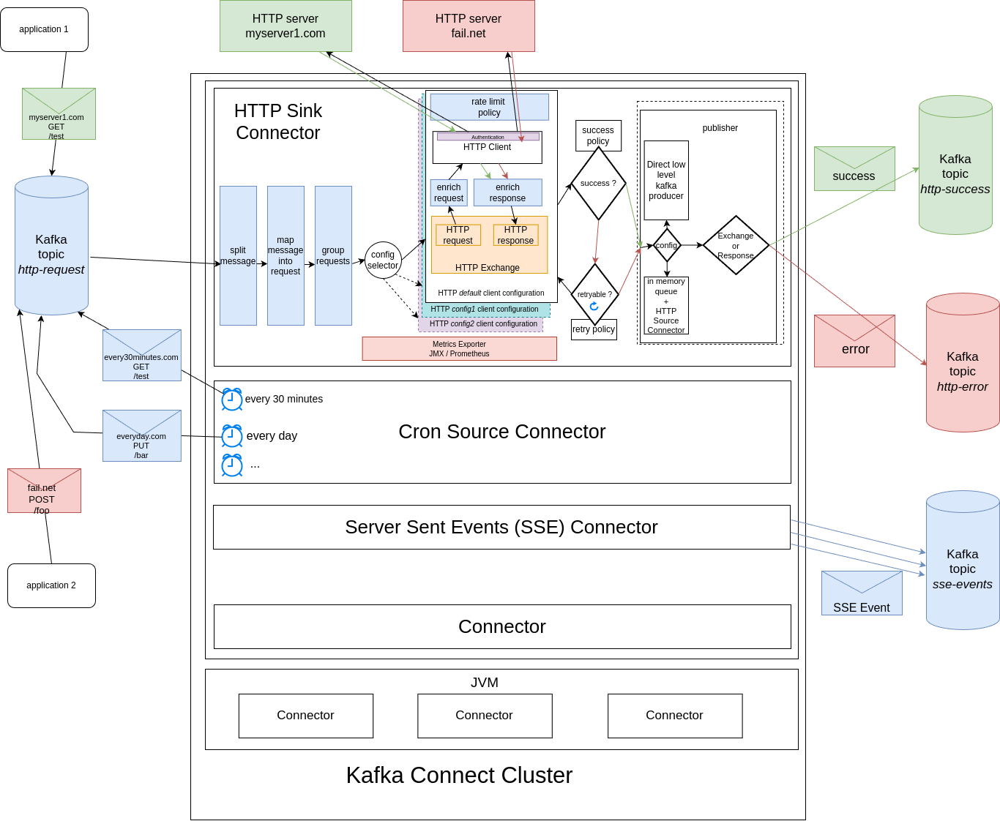

# kafka-connect-http

[](https://github.com/clescot/kafka-connect-http/actions/workflows/build.yaml)
[](https://maven-badges.herokuapp.com/maven-central/io.github.clescot/kafka-connect-http)
[](LICENSE.md)
[](https://sonarcloud.io/summary/new_code?id=clescot_kafka-connect-http)

Call HTTP servers from a Kafka Connect cluster, and optionally publish the responses back to Kafka.



## What this project provides

Kafka Connect moves data between Kafka and external systems, but it does not natively
perform request/response interactions with an HTTP server. This project fills that gap:

- **Send** HTTP requests described by Kafka messages.
- **Receive** the HTTP responses and publish them to Kafka through a low-level producer.
- **Transform** requests and responses with JSONPath, XPath, JMESPath, Regex, DateTime,
  and other template processors.

Kafka Connect is one-way by design. To reconcile that with the two-way nature of HTTP, the
**sink** connector turns Kafka messages into HTTP requests and publishes the responses back
to Kafka with its own producer. See
[Publish modes](docs/explanation/publish-modes.md) for the trade-offs.

## Connectors

| Connector | Kind | Class |
| --- | --- | --- |
| HTTP Sink | Sink | `io.github.clescot.kafka.connect.http.sink.HttpSinkConnector` |
| Cron Source | Source | `io.github.clescot.kafka.connect.http.source.cron.CronSourceConnector` |
| Server-Sent Events (SSE) Source | Source | `io.github.clescot.kafka.connect.sse.client.okhttp.SseSourceConnector` |

## Documentation

The documentation follows the [Diátaxis](https://diataxis.fr/) structure: pick the section
that matches what you are trying to do.

**Learn**
- [Tutorial: your first HTTP exchange](docs/tutorials/first-http-exchange.md)

**Do a task (how-to)**
- [Install the connectors](docs/how-to/install.md)
- [Quick start configurations](docs/how-to/quick-start.md)
- [Choose a publish mode](docs/how-to/choose-a-publish-mode.md)
- [Configure authentication](docs/how-to/configure-authentication.md)
- [Customize exchange templates](docs/how-to/customize-exchange-templates.md)
- [Troubleshoot](docs/how-to/troubleshoot.md)

**Look something up (reference)**
- [HTTP Sink connector settings](docs/reference/http-sink-connector.md)
- [Cron Source connector settings](docs/reference/cron-source-connector.md)
- [SSE Source connector settings](docs/reference/sse-source-connector.md)
- [Message formats](docs/reference/message-formats.md)
- [Exchange template syntax](docs/reference/exchange-template-syntax.md)
- [Metrics](docs/reference/metrics.md)

**Understand (explanation)**
- [Project intention](docs/explanation/project-intention.md)
- [Architecture](docs/explanation/architecture.md)
- [Request handling](docs/explanation/request-handling.md)
- [Publish modes](docs/explanation/publish-modes.md)
- [Scalability](docs/explanation/scalability.md)

A full index is available at [docs/README.md](docs/README.md).

## Quick install

The connectors are shipped as a single Confluent Hub archive that bundles every connector.
Download the latest `clescot-kafka-connect-http-connectors-<version>.zip` from the
[releases](https://github.com/clescot/kafka-connect-http/releases), then install it into your
Kafka Connect image:

```dockerfile
COPY clescot-kafka-connect-http-connectors-<version>.zip /tmp/kafka-connect-http.zip
RUN confluent-hub install /tmp/kafka-connect-http.zip --no-prompt
```

See [install the connectors](docs/how-to/install.md) for the full procedure.

## License

[Apache License 2.0](LICENSE.md).
