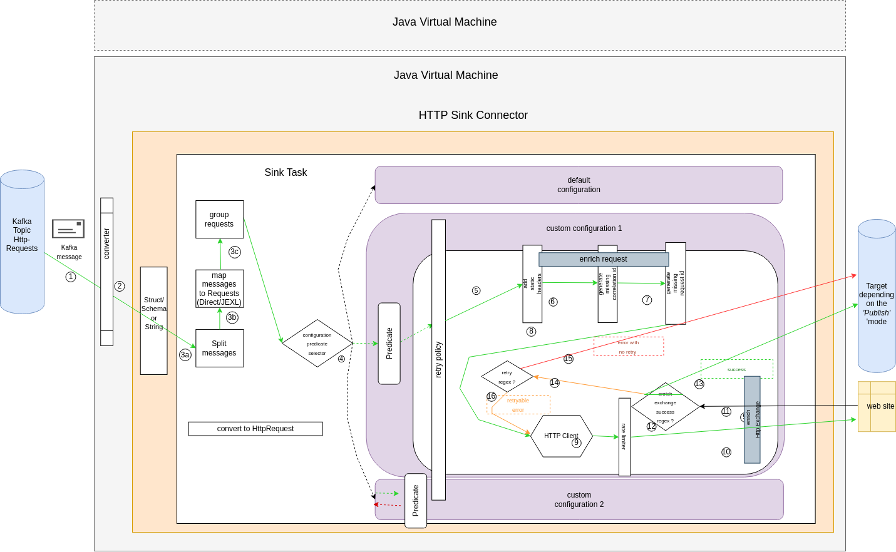

# Architecture

How the HTTP Sink connector turns a Kafka message into an HTTP request and a published
exchange.

The pipeline, in order:

1. The connector **listens** to the incoming request topics (`topics` or `topics.regex`).
2. A **converter** turns each record into a `String` or a structured `Struct` (Avro, JSON
   Schema, or Protobuf).
3. The sink task:
   1. splits each record's value into one or more messages, when a
      [message splitter](../reference/http-sink-connector.md#message-splitters) is configured;
   2. converts each message into an `HttpRequest` using a matching
      [HttpRequestMapper](../reference/http-sink-connector.md#httprequestmapper);
   3. groups several requests into fewer ones, when a
      [request grouper](../reference/http-sink-connector.md#request-groupers) is configured.
4. The task selects the **configuration** whose predicate matches the request.
5. If configured, the configuration adds **static headers**.
6. If configured, the configuration adds a missing **correlation id**.
7. If configured, the configuration adds a missing **request id**.
8. The request is handed to the **HTTP client** (`okhttp` or `ahc`).
9. **Rate limiting** is applied.
10. The request is executed against the server.
11. The response is received and wrapped in an `HttpExchange`, enriched with a **success**
    flag based on `config.<id>.enrich.exchange.success.response.code.regex`.
12. The exchange status drives the next step.
13. On **success**, the exchange is published according to
    [`publish.mode`](../how-to/choose-a-publish-mode.md).
14. On **failure**, the connector checks whether the response code is **retryable**
    (`config.<id>.retry.policy.response.code.regex`).
15. If the error is not retryable, or the retry budget is exhausted, the failing exchange is
    published.
16. If the error is retryable, another HTTP call is made.

The async execution, rate limiting, and retry behaviour are detailed in
[request handling](request-handling.md).
