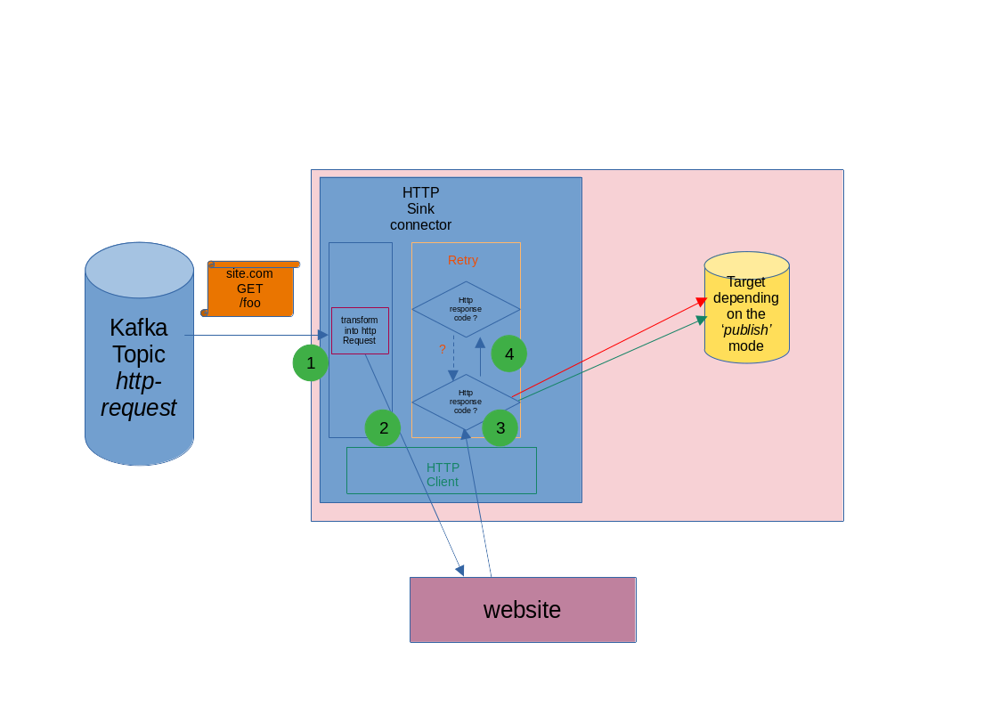

# Request handling

## Asynchronous execution

HTTP requests are executed asynchronously so a slow server cannot bottleneck the connector.
By default the connector uses the platform's **common ForkJoin pool**. A few long-running
requests can exhaust that pool and affect other connectors in the same Kafka Connect worker.

To isolate the connector, configure a dedicated fixed-size thread pool with
`httpclient.async.fixed.thread.pool.size`.

## The request lifecycle

1. The connector reads the incoming message and converts it into an `HttpRequest`.
2. The HTTP client executes the request. A rate limit applies, defined by
   `config.<id>.rate.limiter.period.in.ms` and `config.<id>.rate.limiter.max.executions`.
3. The response becomes an `HttpResponse`. The connector wraps the request, the response, and
   metadata (duration, moment, attempts) into an `HttpExchange`. The response status code is
   tested against `config.<id>.enrich.exchange.success.response.code.regex`; a match sets the
   exchange's `success` flag to `true`.
4. If `success` is `true`, no retry is triggered. If `success` is `false` **and** the status
   code matches `config.<id>.retry.policy.response.code.regex`, a retry is triggered.
5. According to the `success` flag, the exchange is published to the configured success or
   error topic.

## Success and failure

The success decision is a regex applied to the status code, not a fixed range. The default,
`^[1-2][0-9][0-9]$`, treats `1xx` and `2xx` as successes. The retry decision is a separate
regex, `^5[0-9][0-9]$` by default, so only server errors are retried.

Three cases:

- **success** — the status matches the success regex: no retry;
- **functional error** — the status does not match the success regex but is below `500`:
  no retry, published as a failure;
- **technical error** — the status does not match the success regex and is `500` or above:
  retried.

## Retries

Retries follow a backoff policy: `retries`, `retry.delay.in.ms`, `retry.max.delay.in.ms`,
`retry.delay.factor`, and `retry.jitter.in.ms`. Jitter spreads retries in time so many
clients do not hit the server at once.

If a server returns a `Retry-After` header, the connector honours it for the status codes in
`config.<id>.retry.policy.retry.after.status.code`. When the requested delay exceeds the
threshold, the circuit breaker opens instead of waiting.

## Correlating requests and responses

Each `HttpExchange` keeps the incoming record's key and headers, so the published exchange
carries the correlation data of the request that produced it.
